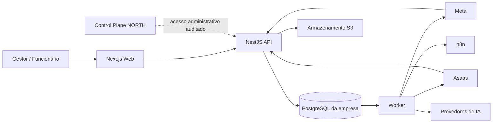

# Blueprint técnico do NORTH

## Visão de componentes



O PostgreSQL é a fonte canônica. API, worker, n8n e IA nunca mantêm uma versão
concorrente do estado de pedidos, estoque ou financeiro.

## Monorepo planejado

```text
apps/
  web/                 interface Next.js
  api/                 API NestJS e webhooks
  worker/              jobs e efeitos assíncronos
  control-plane/       administração NORTH (incremento posterior)
packages/
  domain/              tipos, políticas e eventos sem framework
  application/         casos de uso e portas
  database/            Prisma, SQL e migrações
  auth/                sessões e autorização
  contracts/           schemas HTTP/eventos versionados
  observability/       logs, métricas e traces
  testing/             fixtures e utilitários
infra/
  compose/             dependências locais
  docker/              imagens de produção
docs/                   arquitetura e operação
```

## Módulos do monólito

- Instalação e identidade
- CRM e pós-venda
- Catálogo e precificação
- Arte e documentos
- Pedidos e produção
- Estoque e compras
- Financeiro
- Entrega
- Comunicação e IA
- Auditoria e administração

Cada módulo publica comandos, consultas e eventos. Módulos vizinhos não escrevem
diretamente em suas tabelas.

## Padrões de consistência

- Comando mutável recebe `idempotencyKey` quando puder ser reenviado.
- Webhook usa chave única do provedor e mantém payload bruto protegido para suporte.
- Outbox é gravada na mesma transação do estado de negócio.
- Worker reivindica jobs com bloqueio concorrente, heartbeat, limite de tentativas e
  fila de erro.
- Projeções de saldo podem ser recalculadas a partir do razão.
- Correções são eventos compensatórios; exclusão física não corrige negócio.

## Fronteira administrativa

O plano de controle conhece instalação, versão implantada, saúde, contrato e dados
mínimos de suporte. Ele não agrega o banco operacional das empresas. Para auditoria
completa, o Administrador NORTH solicita acesso temporário e somente leitura à
instalação; motivo, recursos consultados e exportações ficam registrados.

## Ambientes

- Local: uma instalação fictícia, PostgreSQL e armazenamento de teste.
- CI: banco efêmero por suíte, migrações desde zero e testes de concorrência.
- Staging: instalação isolada com credenciais sandbox Meta/Asaas.
- Produção: instalação por empresa, segredos exclusivos, backups e observabilidade.

## Qualidade mínima por incremento

- lint, checagem de tipos e formatação;
- testes unitários de políticas;
- integração real com PostgreSQL;
- testes HTTP de autorização e idempotência;
- Playwright para fluxo crítico da interface;
- migração testada do zero e sobre versão anterior;
- evidências de execução registradas no documento do sprint.
